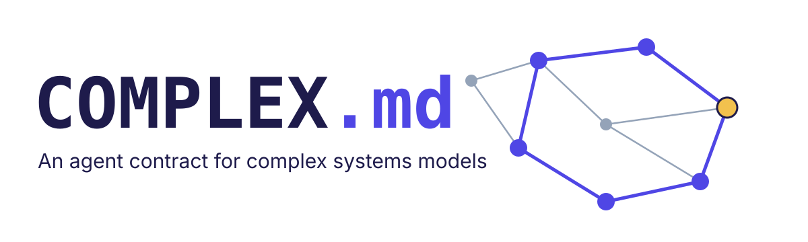
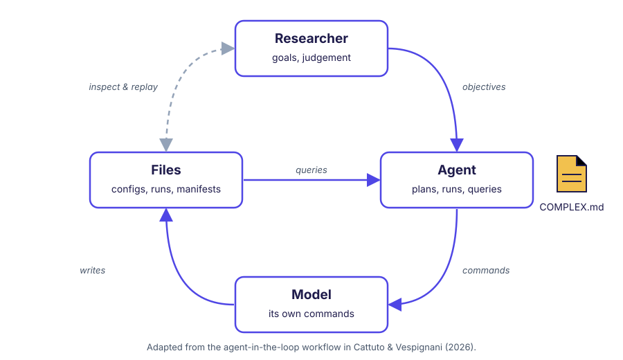

<p align="center">
  
</p>

<p align="center">
  
  
  
</p>

# COMPLEX.md

**Models describe the world. COMPLEX.md describes the model to whoever runs it.**

COMPLEX.md is a Markdown convention for simulators and libraries of complex systems. A single
file in the model's repository tells a researcher or an AI agent how to discover the model,
configure and run it, query its results and combine it with other tools, and where its limits
are. It is a practical take on the agent contract proposed by Cattuto and Vespignani in
*npj Complexity* (2026).

## Why

Simulators for epidemics, networks, opinion dynamics or infrastructure were mostly built for
people working in scripts and notebooks. An AI agent that tries to drive them has to read
source code to learn what can be configured, write throwaway programs to assemble a run, and
dig through large outputs. Cattuto and Vespignani argue that such models need an
agent-friendly interface and a contract that announces it, read by the agent before it starts.
COMPLEX.md is that contract, in plain Markdown.

## How it fits together

<p align="center">
  
</p>

The researcher owns the question and judges the answers. The agent reads COMPLEX.md, then
plans, runs and queries the model through the model's own commands. Everything it does ends up
as files that the researcher can open and repeat.

## Six principles, one section each

| Principle (from the paper) | What the agent learns | Section in COMPLEX.md |
| --- | --- | --- |
| Discoverability/Introspection | which models, parameters, ranges and interventions exist | Discover |
| Declarative control | how to write and validate a complete run description | Configure |
| Statelessness | how to run from files alone, without a session | Run |
| Structured, queryable output | where results live, what each command returns, how to ask results questions | Results |
| Human-Agent parity | how a person repeats exactly what the agent did | Same commands for people and agents |
| Composability | which outputs feed other tools and models | Compose |

Following the paper, COMPLEX.md also lists the model's canonical workflows, its domain
conventions, reporting conventions and worked examples. It adds what an agent needs before it
starts: purpose and scales, limits, when to stop and ask, when leaving the interface is
acceptable, and how the contract improves. [docs/principles.md](docs/principles.md) marks
which parts come from the paper and which are additions of this project.

## Quick start

```bash
pip install complexmd          # or: uv tool install complexmd
cd path/to/your-model
complexmd init --system "My simulator" --command mysim
complexmd check
```

No installation needed? Copy [the template](src/complexmd/templates/full.md) into your
repository as `COMPLEX.md` and fill it in.

## Make agents read it

Agents only read what they are pointed to. For Claude Code, add this line to `CLAUDE.md`:

```markdown
@COMPLEX.md
```

For other agents, add a sentence to `AGENTS.md` that asks them to read COMPLEX.md before
operating the model. Details: [docs/agent-integration.md](docs/agent-integration.md).

## A contract that improves with use

A COMPLEX.md is never finished. Give an agent a realistic request and nothing but the contract
and the interface; let a second agent review its logs and outputs; turn what went wrong into
revisions, approved by a maintainer and recorded in the revision log. Repeated escalations
show which features the interface still lacks. How to run such a round:
[docs/living-contract.md](docs/living-contract.md).

## A valid file is a commitment, not proof

`complexmd check` verifies that a contract has the expected structure. It does not run the model.
Whether an agent can really work with it is shown only by a review round as described above.

## Examples

| Example | Shows |
| --- | --- |
| [Epidemic model](examples/epidemic-model/COMPLEX.md) | a CLI layer around an existing compartmental library |
| [Opinion dynamics](examples/opinion-dynamics/COMPLEX.md) | an agent-based model on networks, with seeds and ensembles |

Both systems are fictional.

## Roadmap

- A small runnable reference model that demonstrates all six principles.
- A documented review round on that model.
- A check that the commands listed in a contract actually exist.
- A shared layout for run directories and manifests.
- Task collections that can serve as benchmarks.

## Citation

If you use COMPLEX.md, please cite the paper that motivated it:

> Cattuto, C. & Vespignani, A. Computational models of complex systems meet AI agents.
> *npj Complexity* (2026). https://doi.org/10.1038/s44260-026-00102-1

Citation metadata for this repository is in [CITATION.cff](CITATION.cff).

## Contributing and license

Contributions are welcome, especially reports from real models. See
[CONTRIBUTING.md](CONTRIBUTING.md). Released under the [MIT License](LICENSE).
